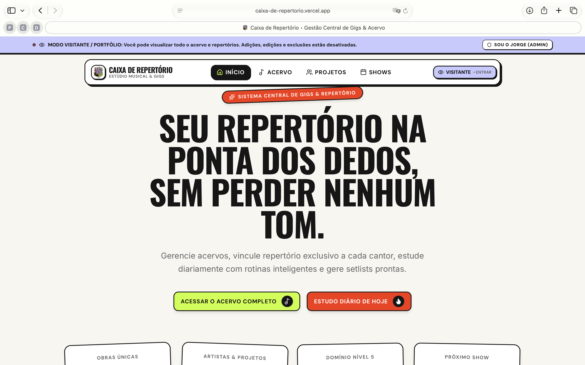
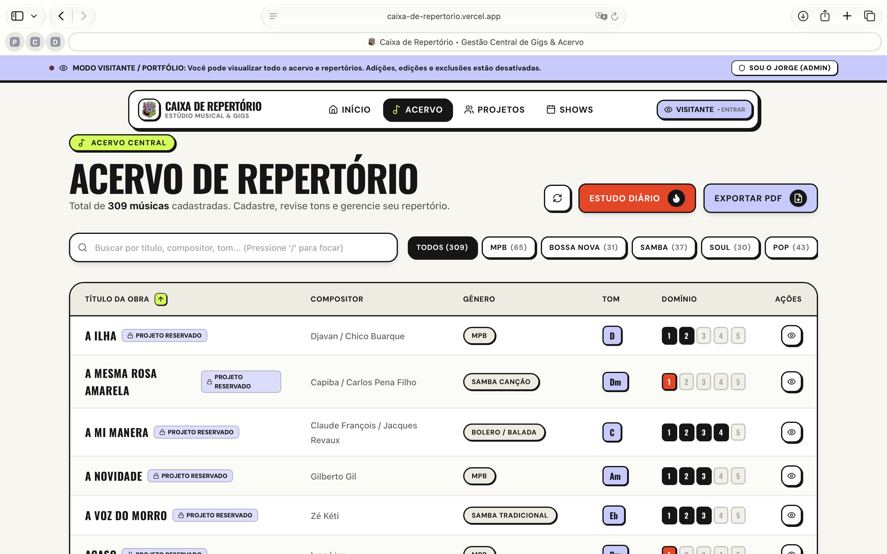
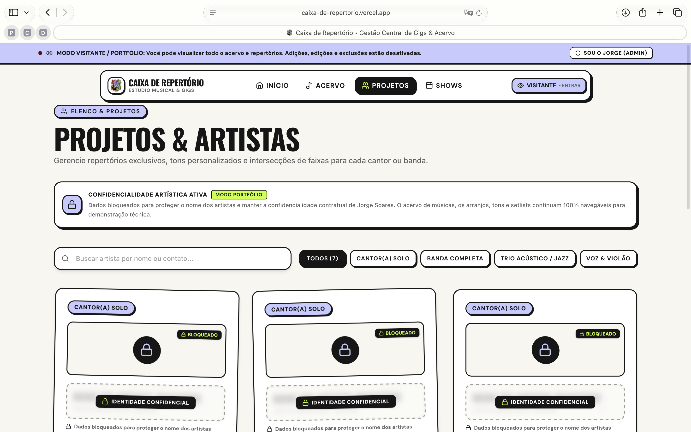
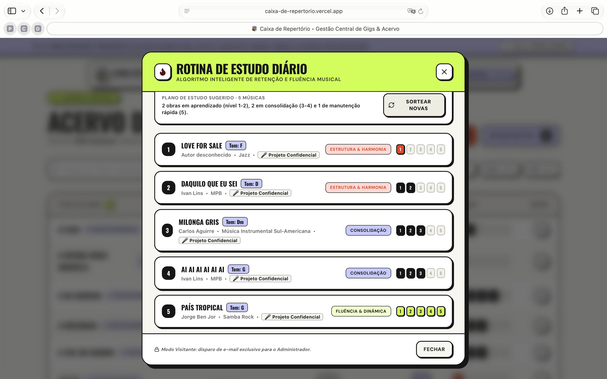
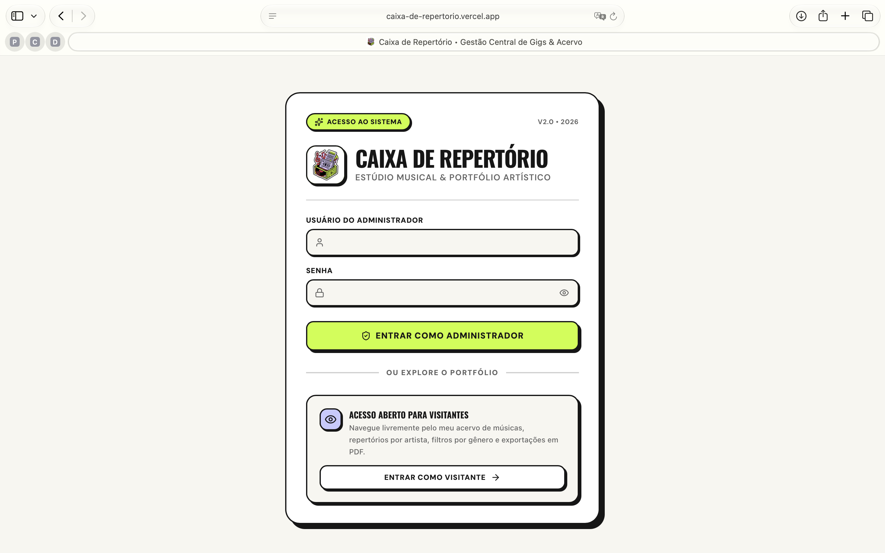

<div align="center">
  
</div>

<h1 align="center">Caixa de Repertório</h1>

<div align="center">
  <a href="https://github.com/jorgesoares2997/caixa_de_repertorio">
    
  </a>
  <a href="https://nextjs.org/">
    
  </a>
  <a href="https://spring.io/projects/spring-boot">
    
  </a>
  <a href="https://neon.tech/">
    
  </a>
  <a href="https://github.com/EvolutionAPI/evolution-api">
    
  </a>
</div>

## 🎯 O problema que o projeto resolve
Músicos profissionais, diretores musicais e bandas enfrentam uma desorganização frequente ao gerenciar repertórios extensos com múltiplos cantores e formações instrumentais distintas:
* **Tons Divergentes:** A mesma canção é executada em *F#m* com um cantor, em *Am* com outro artista e em *Em* no formato voz e violão. A falta de registro centralizado gera erros críticos em cima do palco.
* **Falta de Método no Estudo Diário:** Dificuldade em priorizar o que estudar antes do próximo show, sem clareza de quais músicas estão consolidadas (nível 5) e quais necessitam de revisão urgente de harmonia ou estrutura.
* **Processos Manuais e Atrito de Comunicação:** Digitar setlists manualmente no WhatsApp minutos antes do show, copiar e colar cifras dispersas ou perder anotações em blocos de papel.
* **Equilíbrio entre Portfólio e Privacidade Artística:** Necessidade de apresentar um sistema 100% funcional em portfólio público sem expor contatos privados ou nomes de artistas parceiros sob sigilo profissional.

O **Caixa de Repertório** unifica todo o ciclo musical em uma plataforma moderna e tátil com estética **Neo-Brutalista**, combinando cache instantâneo de zero latência, matriz relacional de tons por projeto, rotinas diárias automatizadas de estudo com foco semanal, envio instantâneo de escalas no WhatsApp via Evolution API e exportação profissional de acervos em PDF vetorial.

## 🛠 Tecnologias utilizadas
- **Frontend & UI**: [Next.js (v16)](https://nextjs.org/) com App Router e Turbopack, [React (v19)](https://react.dev/).
- **Linguagens**: [TypeScript](https://www.typescriptlang.org/) no ecossistema cliente e [Java 17](https://www.oracle.com/java/) no ecossistema servidor.
- **Estilização & Componentes**: [Tailwind CSS (v4)](https://tailwindcss.com/) com design system Neo-Brutalista de alto contraste (bordas sólidas, drop shadows táteis e paleta neon), [Lucide React](https://lucide.dev/) para ícones e [Framer Motion](https://www.framer.com/motion/) para transições fluidas.
- **Gerenciamento de Estado & Cache**: [Zustand 5](https://zustand-demo.pmnd.rs/) com persistência no `localStorage` (carregamento otimista em 0ms).
- **Tabelas & Filtros Dinâmicos**: [TanStack React Table (v8)](https://tanstack.com/table/v8) para paginação, ordenação multi-coluna e busca global via atalho de teclado (`/`).
- **Backend & API**: [Spring Boot 3 (v3.3.4)](https://spring.io/projects/spring-boot), Spring Data JPA, Hibernate ORM, Bean Validation e arquitetura em camadas (Controllers, Services, Repositories, DTOs).
- **Banco de Dados & Migrações**: [Neon Serverless PostgreSQL](https://neon.tech/) com connection pooling de alta performance e versionamento declarativo via [Flyway](https://flywaydb.org/) (`V1`, `V2`, `V3`).
- **Comunicação & Mensageria**: [Spring Boot Starter Mail](https://spring.io/) com JavaMailSender (SMTP TLS Gmail) para automação da rotina diária de estudos e integração com a [Evolution API](https://github.com/EvolutionAPI/evolution-api) para envio programático de setlists no WhatsApp.
- **Motor de PDF**: [iText 7 Core (v8.0.2)](https://itextpdf.com/) para geração de partituras/repertórios em PDF vetorial de alta definição com paginação dinâmica e sumário segmentado.
- **Automação & Tarefas**: Spring `@Scheduled` com suporte a timezone explícito (`America/Sao_Paulo`) para rotina de estudo matinal às 08:00 com algoritmo de retenção balanceada.

## 🚀 Como rodar ou acessar o projeto

### Pré-requisitos
- **Node.js (v20+)** e gerenciador de pacotes **pnpm** (ou npm)
- **Java Development Kit (JDK 17)** e **Apache Maven (v3.9+)**
- Conta ou instância do **PostgreSQL** (ou banco serverless no [Neon](https://neon.tech/))

---

### Instalação e Execução local

#### 1. Clonar o repositório
```bash
git clone https://github.com/jorgesoares2997/caixa_de_repertorio.git
cd caixa_de_repertorio
```

#### 2. Configurar e rodar o Backend (Spring Boot)
1. Crie ou configure o arquivo `backend/.env`:
   ```env
   # Neon PostgreSQL
   SPRING_DATASOURCE_URL=jdbc:postgresql://<neon_host>/neondb?sslmode=require
   SPRING_DATASOURCE_USERNAME=neondb_owner
   SPRING_DATASOURCE_PASSWORD=your_neon_password

   # SMTP Gmail para Envio de Rotina Diária
   SPRING_MAIL_HOST=smtp.gmail.com
   SPRING_MAIL_PORT=587
   SPRING_MAIL_USERNAME=seu_email@gmail.com
   SPRING_MAIL_PASSWORD=sua_senha_de_aplicativo_gmail
   SPRING_MAIL_PROPERTIES_MAIL_SMTP_AUTH=true
   SPRING_MAIL_PROPERTIES_MAIL_SMTP_STARTTLS_ENABLE=true
   APP_PRACTICE_ZONE=America/Sao_Paulo

   # WhatsApp Evolution API (Opcional)
   EVOLUTION_API_URL=https://sua-instancia-evolution.com
   EVOLUTION_API_APIKEY=sua_api_key
   EVOLUTION_API_INSTANCE=seu_nome_instancia
   WHATSAPP_TARGET_NUMBER=5511999999999
   ```

2. Execute o backend via Maven:
   ```bash
   cd backend
   mvn clean spring-boot:run
   ```
   *O backend iniciará na porta `http://localhost:8080`.*

#### 3. Configurar e rodar o Frontend (Next.js)
1. Configure o arquivo `frontend/.env`:
   ```env
   NEXT_PUBLIC_API_URL=http://localhost:8080
   ```

2. Instale as dependências e inicie o servidor:
   ```bash
   cd frontend
   pnpm install
   pnpm run dev
   ```
   *O frontend estará disponível em `http://localhost:3000`.*

---

### Setup do Banco de Dados (Neon Postgres & Flyway)
O projeto utiliza o **Flyway** para migrações automatizadas. Ao inicializar o backend pela primeira vez, as seguintes migrações serão executadas diretamente no Neon:
- `V1__init.sql`: Cria as tabelas de músicas, representantes/artistas, intersecções de tons, shows e logs de prática.
- `V2__create_app_users.sql`: Criação da tabela de usuários administrativos e visitantes.
- `V3__create_weekly_practice_config.sql`: Criação da tabela de persistência do foco semanal de artistas com expiração automática aos domingos.

*(Opcional)* Para popular o catálogo inicial com mais de 240+ canções clássicas:
```bash
node backend/seed-neon.js
```

---

### Automação de Notificações & Rotina Diária
O sistema conta com um agendador automatizado no backend configurado em `DailyPracticeScheduler`:
- **Disparo Diário**: Todos os dias pontualmente às **08:00 (Horário de Brasília)** para a caixa de e-mail cadastrada.
- **Algoritmo de Retenção Espaçada**: Seleciona estrategicamente 2 músicas em aprendizado (nível 1-2), 2 em consolidação (nível 3-4) e 1 de manutenção rápida de palco (nível 5).
- **Foco Semanal de Shows**: Caso haja artistas selecionados para a semana, o sorteio restringe-se exclusivamente aos repertórios e tons dessas apresentações, retornando ao modo Geral após o domingo.

## ✨ Principais funcionalidades
- **Catálogo Unificado de Obras (CRUD Completo)**: Gestão de centenas de músicas com título, compositor, gênero, tom original, andamento em BPM e notas de cifra.
- **Níveis de Domínio Visual (1 a 5)**: Acompanhamento da segurança de palco de cada canção (*1: Aprendendo, 2: Em ensaio, 3: Toca com cifra, 4: Seguro de cor, 5: Pronto para palco*).
- **Matriz de Intersecção de Tons por Artista**: Visualização imediata dos tons específicos cantados por cada artista na mesma música, evitando divergências em ensaios.
- **Foco Semanal de Shows com Expiração aos Domingos**: Possibilidade de restringir o sorteio do estudo diário para 1 ou múltiplos cantores da semana corrente, expirando automaticamente à meia-noite de domingo.
- **Disparo de Rotina Diária por E-mail (HTML Formatado)**: E-mails responsivos com cards estéticos, tons de execução, BPM e foco de exercícios de aquecimento e memorização.
- **Modo Visitante com Confidencialidade Artística**: Acesso livre à home page para demonstração de portfólio. Visitantes navegam pelas setlists com efeito de blur fosco (*frosted glass*), badge de identidade protegida e aviso de confidencialidade sem expor os nomes reais dos clientes.
- **Exportação de Acervo em PDF Vetorial**: Motor iText 7 que gera relatórios para impressão ou leitura em tablet na estante, divididos por compositor ou gênero musical.
- **Disparo de Escala no WhatsApp (Evolution API)**: Envio com 1 clique da ordem do show formatada por blocos, datas, horários e tons em negrito diretamente no grupo dos músicos.

## 🧠 Decisões técnicas tomadas
- **Arquitetura Híbrida (Uso Real pelo Músico vs. Demonstração em Portfólio)**: Para conciliar o uso diário de Jorge Soares com a apresentação pública de seu código, implementou-se um controle de acesso via token assinado (`AuthInterceptor`). Visitantes têm permissão total de leitura para explorar o sistema, mas as operações de escrita são restritas e os dados sensíveis dos artistas são protegidos no backend e mascarados antes do envio ao DOM.
- **Foco Semanal com Expiração Transitória no Banco de Dados**: Em vez de depender de controles manuais em que o usuário precisaria lembrar de desativar o filtro após as apresentações do final de semana, a tabela `weekly_practice_config` armazena a data do domingo (`expiresAt`). Ao virar a semana, o algoritmo identifica a expiração e retorna imediatamente para o modo Geral.
- **Subqueries SQL Otimizadas para Sorteio Aleatório**: Para contornar limitações do PostgreSQL onde o uso de `DISTINCT` conflita com `ORDER BY RANDOM()`, o repositório utiliza subqueries com `IN (SELECT rs.song_id ...)` que eliminam redundâncias mantendo a aleatoriedade e tempo de resposta na casa dos milissegundos.
- **Persistência Otimista com Zustand no Cliente**: A combinação de Zustand com `localStorage` viabilizou um carregamento em 0ms (zero tela branca). As alterações de nível de domínio e notas são refletidas na interface instantaneamente enquanto a sincronização ocorre em background.
- **Timezone Explícito para Infraestrutura em Nuvem**: Servidores em nuvem (como Render e AWS) executam seus contêineres em UTC por padrão. A declaração explícita de `zone = "America/Sao_Paulo"` na anotação `@Scheduled` assegura que os e-mails de estudo matinal cheguem exatamente às 08:00 no fuso de Brasília.

## 📸 Prints, vídeo, deploy ou exemplos de uso

### Página Inicial (Dashboard & Métricas de Palco)


### Catálogo Central de Repertório (Busca, Filtros & Domínio)


### Gestão de Artistas & Matriz de Tons


### Rotina de Estudo Diário & Foco Semanal por Artista


### Autenticação Segura & Modo Portfólio para Visitantes


## 🔮 Próximos passos de melhoria
- **Player Integrado de Áudio & Cifras**: Visualizador dinâmico de cifras com player flutuante para reproduzir gravações de ensaio e áudios-guia enquanto acompanha a harmonia.
- **Importação Automática via Spotify / Cifra Club**: Sincronização automática de tom original, autor e andamento a partir de links públicos de músicas.
- **Modo Palco Offline (PWA)**: Transformar a visualização de setlists em Progressive Web App com suporte a pedal Bluetooth (troca de páginas) e rolagem automática ajustável ao BPM.
